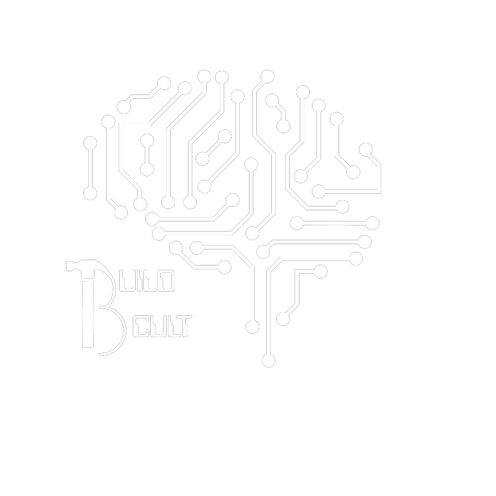

<div align="center">



# BUILDCULT

### Shipping the result. Building the cult.

The website for **Build Cult**, a builder-driven community that turns ideas into real, tangible outcomes. Members don't just participate. They create, experiment, and ship.

[](https://react.dev)
[](https://www.typescriptlang.org)
[](https://vite.dev)
[](https://tailwindcss.com)
[](https://threejs.org)

[Instagram](https://www.instagram.com/buildcult/) · [X / Twitter](https://x.com/Build_Cult) · [LinkedIn](https://www.linkedin.com/company/buildcult/about/)

</div>

---

## Table of Contents

- [Highlights](#highlights)
- [Pages](#pages)
- [Tech Stack](#tech-stack)
- [Getting Started](#getting-started)
- [Scripts](#scripts)
- [Project Structure](#project-structure)
- [Customization](#customization)
- [Meet Pitti Pitti](#meet-pitti-pitti)
- [Contributing](#contributing)

---

## Highlights

- **3D perspective tunnel intro.** A warp-speed entrance through the hackathon photos, with a smooth blur-and-scale transition into the site.
- **Animated gradient orb background.** A WebGL shader backdrop (React Three Fiber) that lives behind every page.
- **Glass UI.** Glassmorphic headings, cards, and folders in a dark-first theme.
- **Interactive team lanyard rail.** Flippable ID badges for the core team.
- **Dotted trail cursor.** A custom cursor effect on the Services page.
- **Past events gallery.** Glass-folder style browsing of hackathon photos and resources.
- **Join Us portal.** An application form with department selection.
- **Pitti Pitti.** A tiny black rabbit that roams your screen, talks, and looks after you.
- **Fully responsive**, with reduced-motion support in the animated components.

## Pages

| Route | What it is |
| --- | --- |
| `/` (Home) | Hero, brand marquee, past events, and a collaborate call to action |
| `#intro` | The 3D tunnel intro, which can be replayed from the nav |
| `#core` | Meet the core team |
| `#services` | What Build Cult offers |
| `#join-us` | Apply to join the cult |

Navigation is hash-based, so every page can be deep-linked directly (for example `yoursite.com/#services`).

### What we do

| | |
| --- | --- |
| **Hackathons & Build Sprints** | 24 to 48 hour sprints from blank canvas to shipped code, with mentorship, peer review, and demo day. |
| **Collaborative Squad Projects** | Cross-disciplinary teams of developers, designers, and operators building real MVPs and open-source software. |
| **Next-Gen Web & Interactive Craft** | WebGL, physics engines, and micro-interactions that elevate web experiences. |
| **Builder Ecosystem & Campus Chapters** | A growing network across campuses and cities for real work and shared knowledge. |

### Join us in

Engineering · Design & Motion · Community & Events · DevRel & Growth

## Tech Stack

| Area | Tools |
| --- | --- |
| Framework | React 19, TypeScript, Vite |
| Styling | Tailwind CSS v4, `class-variance-authority`, `clsx`, `tailwind-merge` |
| UI primitives | Radix UI (Dialog, Navigation Menu, Label, Slot), shadcn/ui conventions |
| Animation | Framer Motion / Motion |
| 3D & shaders | Three.js, React Three Fiber |
| Icons | Lucide React, Radix Icons |
| Fonts | Syne, Plus Jakarta Sans, Instrument Serif |
| Tooling | Oxlint, Sharp, heic-convert |

## Getting Started

### Prerequisites

- [Node.js](https://nodejs.org) 20 or newer
- npm

### Installation

```bash
# 1. Clone the repository
git clone https://github.com/<your-username>/buildcultwebsite.git
cd buildcultwebsite

# 2. Install dependencies
npm install

# 3. Start the dev server
npm run dev
```

Then open the local URL Vite prints, usually <http://localhost:5173>.

### Production build

```bash
npm run build     # type-check and build to /dist
npm run preview   # preview the production build locally
```

## Scripts

| Command | Description |
| --- | --- |
| `npm run dev` | Start the Vite dev server with HMR |
| `npm run build` | Type-check with `tsc -b`, then build for production |
| `npm run preview` | Serve the production build locally |
| `npm run lint` | Lint the project with Oxlint |

## Project Structure

```
buildcultwebsite/
├── public/                  # Static assets: logo, favicon, team portraits, hackathon photos
├── pictures/                # Raw event media (HEIC/JPG/MOV) before optimization
├── convert-heic.cjs         # Script to convert HEIC photos to web-friendly JPGs
├── index.html               # Entry HTML (fonts, favicon, dark mode class)
└── src/
    ├── App.tsx              # Hash-based routing and page orchestration
    ├── main.tsx             # App entry point
    ├── index.css            # Tailwind, theme tokens, glass utilities
    ├── lib/utils.ts         # Helpers (cn)
    └── components/
        ├── pages/           # core-page, services-page, join-us-page
        ├── PittiPitti/      # The roaming rabbit mascot
        └── ui/              # Reusable UI: hero, footer, glass-folder,
                             # team-lanyard-rail, perspective-tunnel-hero,
                             # gradient-orb, dotted-trail-cursor, and more
```

## Customization

**Add or edit team members.** Update the array in `src/components/ui/core-section.tsx` (name, role, portrait, and links), and drop the portrait into `public/`.

**Change services.** Edit the `services` array at the top of `src/components/ui/services-section.tsx`.

**Update past events.** Add photos to `public/` and list them in `src/components/ui/past-events-section.tsx`.

**Convert iPhone photos.** Put `.HEIC` files in `pictures/` and run:

```bash
node convert-heic.cjs
```

**Tune Pitti Pitti.** Behavior, colors, and speed live in `src/components/PittiPitti/config.ts`, and the dialogue lives in `messages.ts`.

## Meet Pitti Pitti

A small black rabbit roams the site, naps when you're idle, hops over to your cursor, and reminds you to drink water, stretch, and keep going.

> *"Bugs are just carrots in disguise. Keep going!"* 🥕

## Contributing

Contributions are welcome.

1. Fork the repo
2. Create your branch: `git checkout -b feature/your-idea`
3. Commit your changes: `git commit -m "Add your idea"`
4. Push to the branch: `git push origin feature/your-idea`
5. Open a pull request

Run `npm run lint` and `npm run build` before opening a PR.

---

<div align="center">

**Built by builders, for builders.** 🖤

[Join the Cult](https://www.instagram.com/buildcult/)

</div>
